

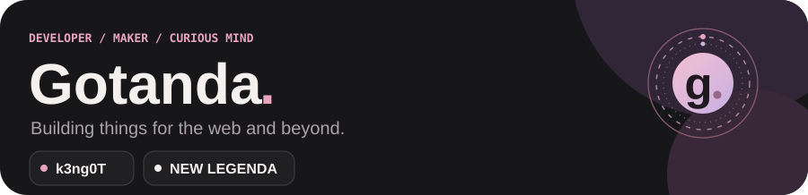

  

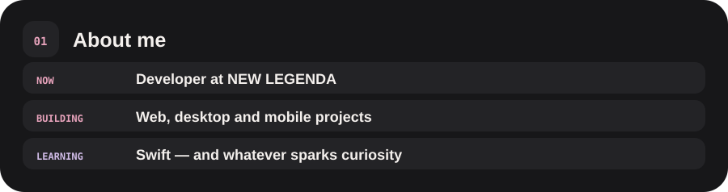

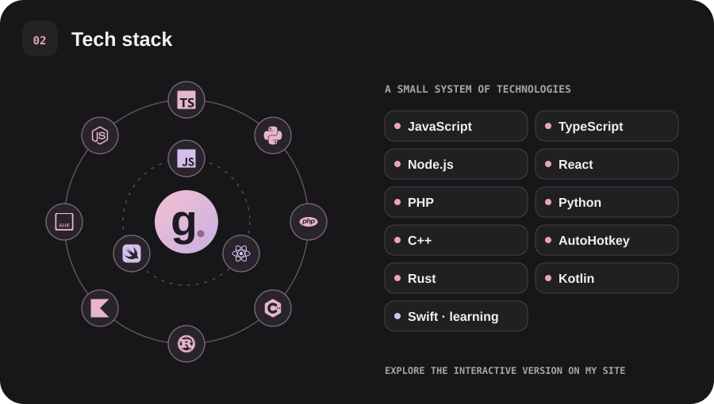

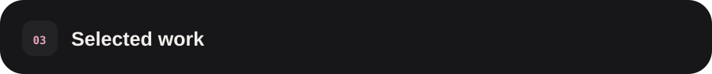

<a href="https://github.com/k3ng0T/Univigate">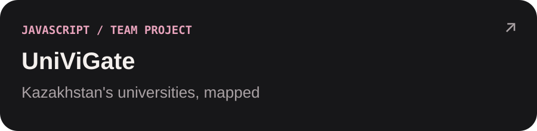</a>
<a href="https://github.com/k3ng0T/Zero-Model">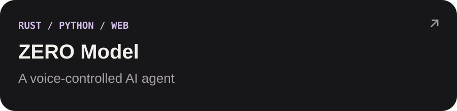</a>
<a href="https://github.com/k3ng0T/messenger.app">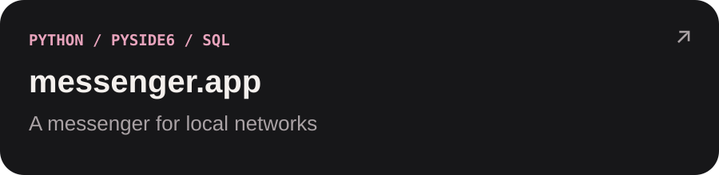</a>
<a href="https://github.com/k3ng0T/personal-hub">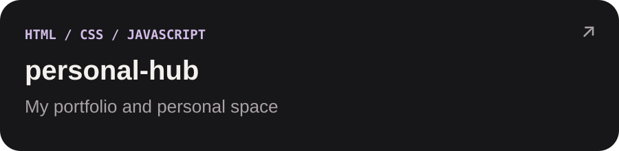</a>
<a href="https://github.com/k3ng0T/SendFlow">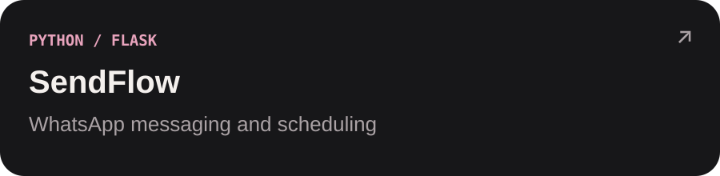</a>
<a href="https://github.com/k3ng0T/PDF-book-READER">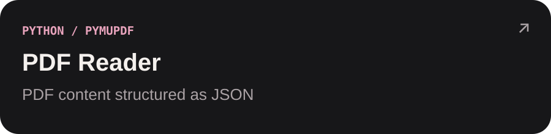</a>

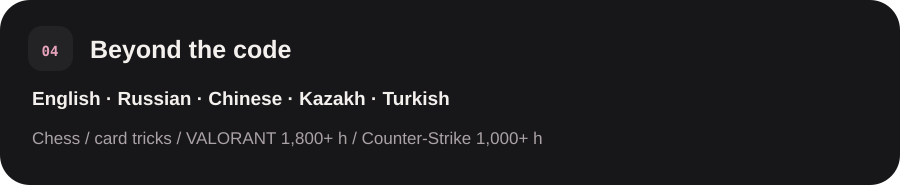

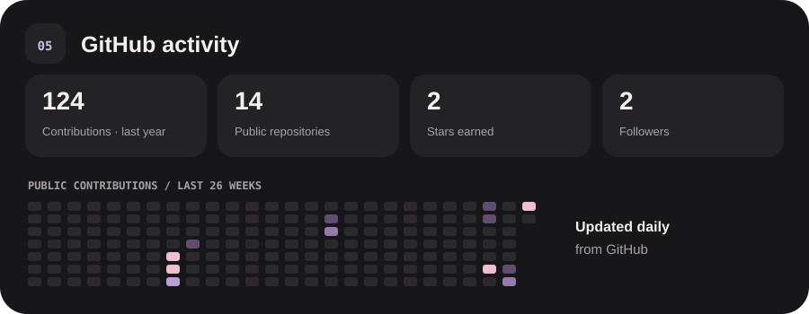

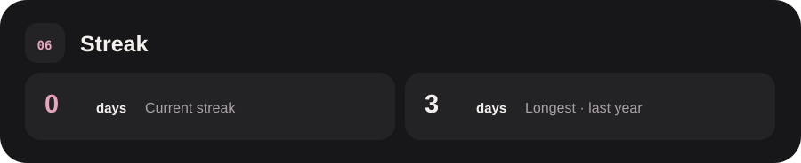

  

GOTANDA / K3NG0T &nbsp; ✳ &nbsp; MADE WITH CURIOSITY

